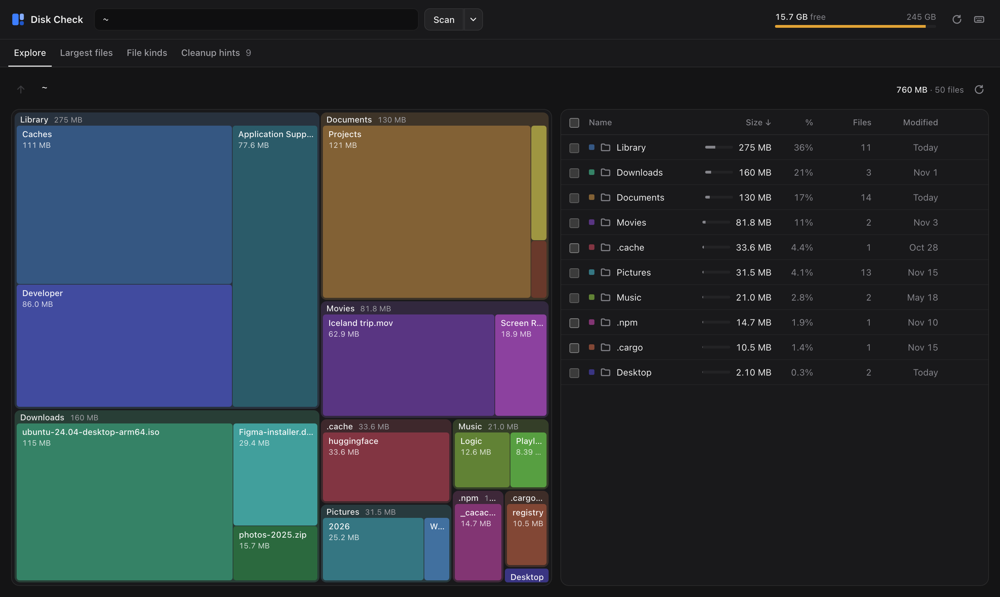
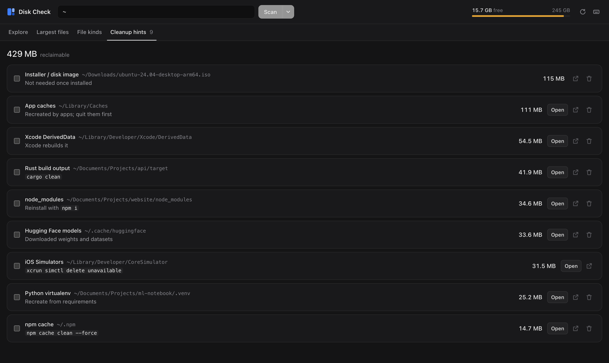
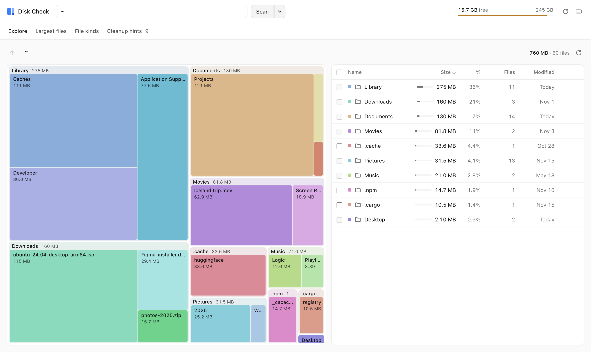

<p align="center"></p>

<h1 align="center">Disk Check</h1>

<p align="center">See what's filling your Mac's disk, and clear it out safely.<br>
A small local app: live treemap, sortable table, cleanup hints. Nothing leaves your machine.</p>



## Features

- **Live scan.** The treemap and table fill in while scanning (about 2M files in roughly 12s on an M-series Mac).
- **Explore.** A nested treemap and a sortable table. Folder colors stay the same as you drill in and out.
- **Largest files, file kinds, cleanup hints.** Hints cover `node_modules`, Xcode DerivedData, simulators, app and package-manager caches, installers and more.
- **Clean up safely.**
  - Move to Trash, with Undo.
  - Pick several items and trash them at once, or copy a paste-safe `trash` / `rm -rf` script.
  - System folders, your home folder and `~/Library` are never touched. Personal folders (`~/Documents`, `~/Desktop`…) need an explicit confirm and are never added to scripts.
- **Stay current.** Rescan just the open folder. The free-space meter shows how much space moved since you last looked.
- **Keyboard first.** Press <kbd>?</kbd> in the app for the full list.

## Install

Requirements:
- macOS 12 or later
- Go 1.22+
- Xcode command-line tools, for the native window (`xcode-select --install`)

```sh
git clone https://github.com/nick-delirium/disk-check
cd disk-check
./make-app.sh --install        # builds "Disk Check.app" and copies it to /Applications
```

Or skip the app bundle and run it from the terminal:

```sh
go build -o disk-check .
./disk-check                   # scans your home folder, opens in the browser
./disk-check -window ~/Downloads
```

## How to use

1. Open **Disk Check**. It scans your home folder right away; the treemap fills in as it goes.
2. Click a tile or row to open a folder. <kbd>⌫</kbd> or <kbd>←</kbd> goes back up. Hover a tile to see its size.
3. Use **Scan ▾** to scan another place (Downloads, Applications, the whole disk) or choose any folder.
4. Look through **Cleanup hints** and **Largest files** for things you don't need.
5. Remove things:
   - **One item:** the trash icon on its row moves it to the Trash, with Undo.
   - **Several items:** tick their checkboxes (or <kbd>⌘</kbd>-click tiles). The bar at the bottom can move them all to the Trash or copy a `trash` / `rm -rf` script for you to review and run yourself.
6. Empty the Trash. When you come back to the app, the free-space meter shows how much you got back.

For complete numbers, add **Disk Check** (or your terminal, if you run the CLI) under
System Settings → Privacy & Security → **Full Disk Access**. Without it, macOS hides Mail, Messages, the Trash and a few other folders.

<details>
<summary>Keyboard shortcuts</summary>

| Key | Action |
|---|---|
| <kbd>↑</kbd> <kbd>↓</kbd> <kbd>Home</kbd> <kbd>End</kbd> | Move through rows |
| <kbd>Enter</kbd> / <kbd>→</kbd> | Open folder |
| <kbd>←</kbd> / <kbd>⌫</kbd> | Up one level |
| <kbd>Space</kbd> · <kbd>⇧</kbd> <kbd>Space</kbd> | Pick · pick a range |
| <kbd>⌘</kbd> click tile · <kbd>⇧</kbd> click row | Pick · pick a range |
| <kbd>⌘</kbd> <kbd>⌫</kbd> | Move to Trash |
| <kbd>R</kbd> | Rescan this folder |
| <kbd>⌘</kbd> <kbd>L</kbd> or <kbd>/</kbd> | Focus the path field |
| <kbd>Esc</kbd> | Close menu · clear picks |
| <kbd>?</kbd> | Show shortcuts |

</details>

<p>


</p>

## How it works

- **The app:** one Go binary using only the standard library, plus a little Objective-C for the native WebKit window. The UI is a single HTML file served on `127.0.0.1`.
- **Scanner:** on macOS it lists each folder with `getattrlistbulk(2)`, which returns names, sizes and dates for a whole batch of entries in one system call. Subfolders are opened relative to their parent, and folders are scanned in parallel, one worker per CPU core. Elsewhere, or when built with `CGO_ENABLED=0`, it falls back to `os.ReadDir` + `lstat`.
- **Sizes:** space actually used on disk, in decimal units like Finder. Hard links count once; symlinks are not followed. Scanning `/` skips `/System/Volumes/Data`, which would double-count the same files, and other mounted drives.
- **Security:** the server listens on localhost only, checks the `Host` header, and every API call needs a random per-run token.
- **Memory:** about 230 bytes per file (≈500 MB for 2.2M files).
- **Benchmark:** `disk-check -bench <folder>` scans once and prints timings without starting the UI. See `bench.go` for the tuning variables.
- **Icon:** the source is `packaging/icon.svg`. `packaging/make-icon.sh` regenerates `AppIcon.icns` (needs Chrome).

## License

[MIT](LICENSE)
